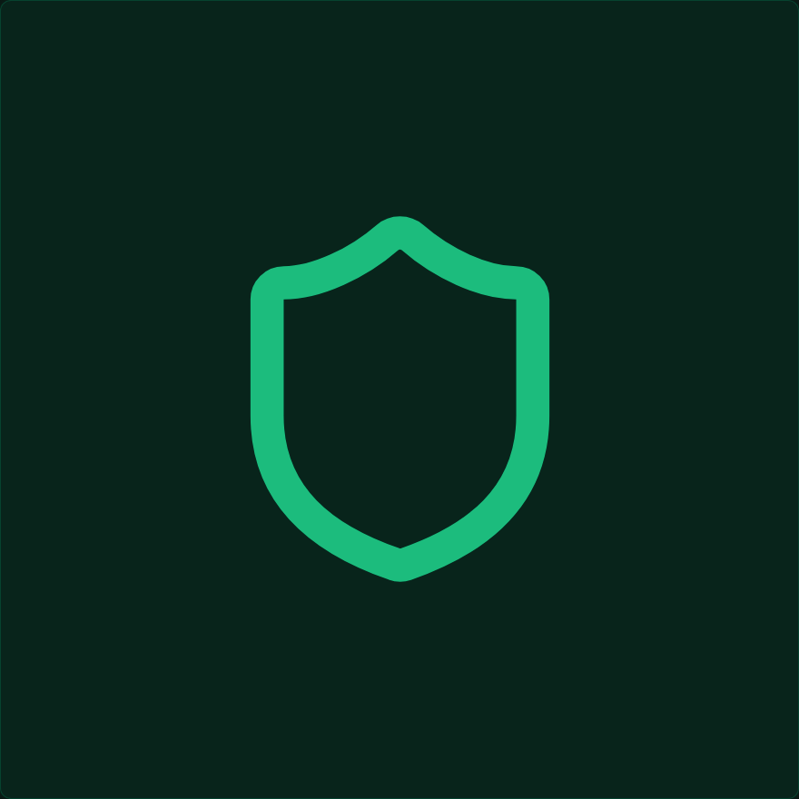

<div align="center">



# Notvex

**Encrypted notes, 100% local. No account, no server, no cloud.**

Your notes live in a single encrypted file on your own disk. No one else — not even Notvex — can read them.

<a href="https://notvex.vercel.app/download" target="_blank"></a>
<a href="https://notvex.vercel.app/download" target="_blank"></a>
<a href="https://notvex.vercel.app/download" target="_blank"></a>


[Website](https://notvex.vercel.app) · [Download](https://notvex.vercel.app/download) · [Docs](https://notvex.vercel.app/docs/getting-started)

</div>

<p align="center">
  
</p>

Notvex is a desktop app for Markdown notes, with no telemetry and nothing to sign up for. The vault is one `.nvx` file that's yours: copy it, back it up, or carry it on a USB drive, and it stays as secure as on your disk.

It runs on Windows, macOS, and Linux, and all of its code is open source, so you don't have to take its security on trust.

## Features

- **A Markdown editor** with live preview as you type, a separate reading view, a formatting toolbar, and find in the note.
- **Notes that save as you type.** Pin the important ones, sort by date or title, search by title, and restore anything from the trash.
- **Color-coded tags** that you can combine to filter the note list.
- **A command palette** (`Ctrl+K`, `Cmd+K` on macOS) to open a note, create one, or run any command without the mouse.
- **As many vaults as you need**, each one a portable file with its own password.
- **Markdown in and out.** Export notes as `.md` files with their tags in YAML front matter, which Obsidian and most Markdown tools read, and import `.md` and `.txt` files.
- **A backup before format upgrades.** When a new version needs to update a vault's format, Notvex saves a copy of the vault first, unless you opt out.

The [user guide](https://notvex.vercel.app/docs/getting-started) walks through each of these, and [keyboard shortcuts](https://notvex.vercel.app/docs/shortcuts) lists them all.

## Security

Notvex is built for one situation: someone gets a copy of your vault file, but not your password. The file on its own should reveal nothing, and guessing the password should be slow.

- **Two layers of encryption.** SQLCipher encrypts the whole database with AES-256, and each note's title and content are encrypted again with XChaCha20-Poly1305.
- **Argon2id** turns your password into the key, tuned to take about 1.5 seconds on your computer, so an attacker pays that cost on every guess.
- **A 24-word recovery key** gets you back in if you forget your password, and an optional key file adds a second factor.
- **The master key never touches the disk.** It lives only in memory, which Notvex asks the OS to keep out of swap, and is wiped when the vault locks: on sleep, on screen lock, after a period of inactivity, and, if you choose, on minimize.
- **No telemetry.** The only network request is the update check on startup, which you can turn off.

What Notvex can't do is protect a vault while it's unlocked on a compromised computer: malware running as you can read the screen and the keyboard. [Security architecture](https://notvex.vercel.app/docs/architecture) explains the design in detail, and [security practices](https://notvex.vercel.app/docs/security-practices) covers the choices left to you.

> [!WARNING]
> **If you lose your master password AND your recovery key, your notes are unrecoverable.** There is no account, no server, no way to reset access. Write your recovery key down by hand or copy it on a device you trust, and keep it somewhere safe.

## Tech stack


The app is organized into three separate processes, orchestrated with **electron-vite**:

- **`src/main`** — Electron main process (Node.js): all vault cryptography, SQLCipher access, and the IPC handlers.
- **`src/preload`** — the `contextBridge` layer that exposes only the `window.notvex` API to the renderer (no Node.js integration).
- **`src/renderer`** — the React 19 + Tailwind CSS 4 + shadcn/ui interface.
- **`src/shared`** — TypeScript types shared across all three processes.

This isolation is intentional: the renderer can never run encryption or SQL code on its own, only through explicitly defined IPC channels.

## Development

### Prerequisites

- [Node.js](https://nodejs.org/) ≥ 22
- [pnpm](https://pnpm.io/)
- Windows: Visual Studio Build Tools with the "Desktop development with C++" workload (required to compile `@journeyapps/sqlcipher`)

### Install

```bash
git clone https://github.com/GFrancV/notvex.git
cd notvex
pnpm install
```

`pnpm install` automatically rebuilds `@journeyapps/sqlcipher` for the installed Electron version.

### Run in development

```bash
pnpm dev
```

### Build

```bash
# Windows
pnpm build:win

# macOS
pnpm build:mac

# Linux
pnpm build:linux
```

Installers are output to `dist/`.

### Check

```bash
pnpm check:task   # typecheck, lint, format, IPC boundary check and tests
```

Run it before opening a PR. [`CONSTRAINTS.md`](./CONSTRAINTS.md) sets the bar it enforces.

## Contributing

1. Fork the repository.
2. Create a descriptive branch (`feat/feature-name`, `fix/bug-name`).
3. Follow the project's conventions:
   - UI components: always reuse what already exists in `src/renderer/src/components/ui/` before building something new.
   - Never hardcode colors — use the semantic Tailwind tokens defined in `main.css`.
   - Dark mode only — no `dark:` variants or light-theme logic.
   - All renderer↔main communication goes through IPC (`ipc-handlers.ts` → `preload/index.ts` → `lib/ipc.ts`); the renderer never imports cryptography or SQL modules directly.
4. Run `pnpm check:task` before opening a PR.
5. Use [Conventional Commits](https://www.conventionalcommits.org/) in lowercase (`feat:`, `fix:`, `chore:`, etc.), max 72 characters in the subject.
6. Open the PR against `main`. CI (`validate.yml` and `react-doctor.yml`) runs on every pull request.

Found a security bug? See [`SECURITY.md`](./SECURITY.md) for how to report it privately.

## License

Notvex is licensed under the AGPL-3.0. See [`LICENSE`](./LICENSE) for the full text.
